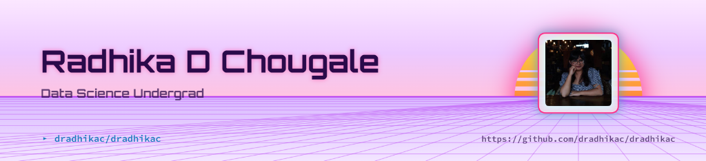

  <picture>
    <source media="(prefers-color-scheme: dark)" srcset="header-dark.png">
    
  </picture>

  

<!-- Note: Profile view counter is powered by visitorbadge.io. It measures cumulative page impressions tracked by the external provider and may not represent unique visitors. -->

  

  I am <b>Radhika D Chougale</b>, a Data Science undergraduate, software developer, and aspiring AI Engineer.

- Currently pursuing a degree in **Data Science** with an emphasis on software engineering and intelligent systems.
- Confident working with **Python**, **Java**, and **R**.
- Experienced in designing and querying relational and document databases with **MySQL** and **MongoDB**.
- Actively exploring **Artificial Intelligence & Machine Learning**, **Retrieval-Augmented Generation (RAG)**, and **AI agents**.
- Enjoy developing software solutions and exploring practical, real-world applications of data science and AI.
- Long-term career objective: engineering robust, production-grade solutions as an **AI Engineer**.

<h2 align="center">Tech Stack</h2>

  

  
  
  
  
  
  
  
  
  
   
  
  
  
  
  
  

<h2 align="center">Featured Projects</h2>

<table width="100%">
  <tr>
    <td width="50%" valign="top">
      <h3>
        <a href="https://github.com/dradhikac/Integrated-Patient-Care-Management-System">
          Integrated Patient Care Management System
        </a>
      </h3>
      
An end-to-end clinical workflow and hospital management platform integrating outpatient queues, electronic health records (EHR), diagnostic laboratory requisitions, and billing. Features smart priority queue triage, digital prescriptions with QR code verification, and an autonomous Groq LLM appointment concierge.

      

        
        
        
        
      

    </td>
    <td width="50%" valign="top">
      <h3>
        <a href="https://github.com/dradhikac/rl-adaptive-bus-perception-system">
          RL Adaptive Bus Perception System
        </a>
      </h3>
      
An intelligent perception and decision-making framework for autonomous urban buses featuring 360° multi-camera object detection across five video feeds. Combines adaptive sensor reliability estimation and blind-spot risk scoring with reinforcement learning action policies and safety overrides in an interactive Streamlit dashboard.

      

        
        
        
        
      

    </td>
  </tr>
  <tr>
    <td width="50%" valign="top">
      <h3>
        <a href="https://github.com/Rahul08092005/FinSage-AI">
          FinSage AI
        </a>
        (by Rahul08092005)
      </h3>
      
A personal wealth management and budgeting platform combining OCR-driven multi-format document ingestion with LangGraph multi-agent orchestration. Provides automated expense tracking, category budgeting gauges, and multi-perspective financial assistance powered by retrieval-augmented generation (RAG).

      

        
        
        
        
      

    </td>
    <td width="50%" valign="top">
      <h3>
        <a href="https://github.com/dradhikac/java-exam-management-system">
          Java Exam Management System
        </a>
      </h3>
      
A console-based university examination management platform engineered with a clean layered architecture and DAO design pattern. Automates student records, attendance tracking, faculty assessment logging, rule-based exam eligibility evaluation, and PDF admit card generation.

      

        
        
        
        
      

    </td>
  </tr>
</table>

<h2 align="center">GitHub Achievements</h2>

  
  &nbsp;&nbsp;
  
  &nbsp;&nbsp;
  

<h2 align="center">Contribution Graph</h2>

  <picture>
    <source media="(prefers-color-scheme: dark)" srcset="https://raw.githubusercontent.com/dradhikac/dradhikac/output/github-contribution-grid-snake-dark.svg" />
    <source media="(prefers-color-scheme: light)" srcset="https://raw.githubusercontent.com/dradhikac/dradhikac/output/github-contribution-grid-snake.svg" />
    
  </picture>

<h2 align="center">Let's Connect</h2>

  
  &nbsp;
  

  

